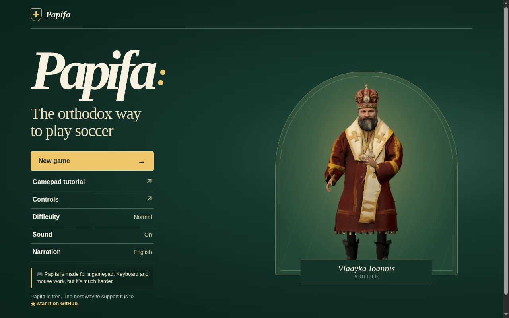
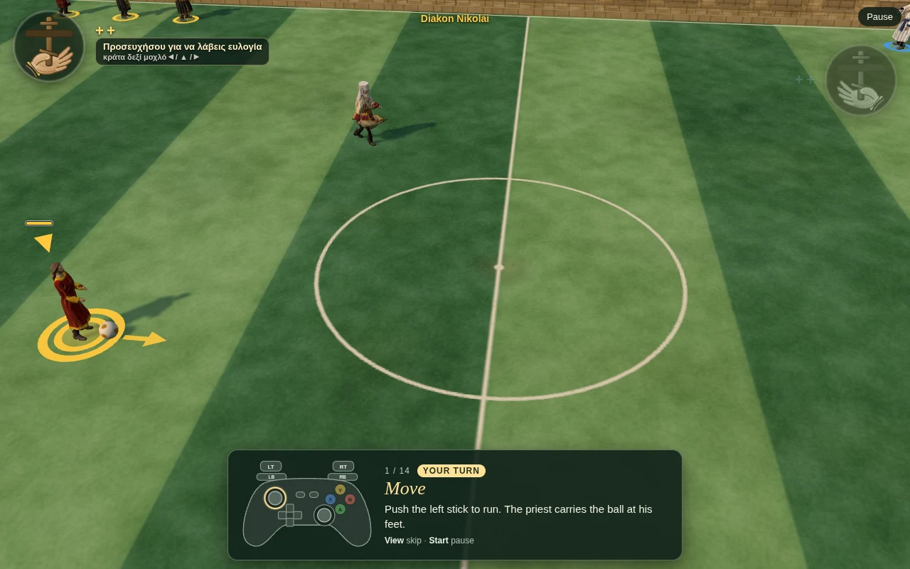

# Papifa

**Papifa: The orthodox way to play soccer** — a fast, arcade 3D football game starring Orthodox priests, playable in the browser and as a standalone Electron desktop app (Windows, Linux, and macOS).

Gameplay is intentionally arcade-first: responsive dribbling, easy passing, assisted shooting, three monastery venues (*Courtyard*, *Meteora cliff-top*, *Winter monastery*), 3v3 and 5v5 matches, local 2-player, online WebRTC P2P multiplayer, and special prayer blessings (including riding St George's white warhorse across the pitch). The polish goes into how the priests move: running, turning, tackling, sliding, kicking, and robes and beards in motion.

## Screenshots

| Title & 3D Portrait | 5v5 Monastery Match |
| :---: | :---: |
|  |  |

| St George Prayer Blessing | Interactive Gamepad Tutorial |
| :---: | :---: |
|  |  |

---

## Play in the browser

### Option 1: Build a self-contained static web release (recommended)

Requires only **Node.js (LTS)** and **Git**:

```bash
node scripts/build-web.mjs --stage ./staged-web
npx --yes http-server ./staged-web -a 127.0.0.1 -p 8790
```

Then open <http://127.0.0.1:8790/> in a modern browser. The build script downloads and SHA-256 verifies a pinned copy of `three@0.170.0` so the staged release loads nothing from external CDNs and runs under a strict Content-Security-Policy.

### Option 2: Direct local dev server (no build step)

Serve `game/` directly (loads Three.js from jsDelivr):

```bash
python3 -m http.server 8790 --bind 127.0.0.1 --directory game
```

Open <http://127.0.0.1:8790/>.

---

## Build the desktop app (Windows, Linux, macOS)

See **[`BUILDING.md`](BUILDING.md)** for plain, step-by-step instructions to build your own standalone Windows `.exe`, Linux `AppImage` / `.tar.gz`, or macOS `.zip` with only **Node.js (LTS)** and **Git**.

Quick version:

```bash
cd desktop
npm ci
npm run build
```

---

## Controls

**Gamepad recommended** — Xbox, PlayStation, or any standard USB/Bluetooth controller works out of the box, and the title menu includes an interactive **Gamepad tutorial** covering every move. Keyboard + mouse and mobile touch controls are also supported.

| Action | Gamepad (Recommended) | Keyboard + Mouse | Touch |
| :--- | :--- | :--- | :--- |
| **Move** | Left stick | WASD / Arrow keys | Drag movement stick |
| **Aim** | Left stick (hold **LT** for autopilot + aim) | Mouse cursor on pitch | Movement stick |
| **Sprint** | Hold **RT** | Hold **Shift** | Drag stick to rim |
| **Pass / Standing tackle** | **A** | **Space** (or right-click pass / left-click tackle) | Tap **Pass** / **Tackle** |
| **Slide tackle** | **X** (or **RT + A**) | **Shift + Space** | — |
| **Shoot / Knock-on** | Hold **B** to shoot · tap far out (or double-tap **RT**) to knock on | Hold **F** or left-click · tap far out (or double-tap **Shift**) to knock on | Hold **Shoot** · tap far out to knock on |
| **Through ball** | **Y** | **E** (or **Shift + right-click**) | Swipe up on **Pass** |
| **Chip shot** | **LB + B** | **C** | Hold **Shoot**, swipe up & release |
| **One-two** | **LB + A** | **Q** with the ball | Swipe right on **Pass** |
| **Switch / Call press** | Tap **LB** / Hold **RB** | Tap **Q** (or right-click) / Hold **Q** | Tap **Switch** / Hold **Switch** |
| **Pray (2 slots per match)** | Hold right stick 2 s: ◀ Jesus · ▲ St George · ▶ Mother Mary | Hold **R** 2 s, then **1** (Jesus) · **2** (Mary) · **3** (St George) | Hold **Pray** 2 s, then tap blessing |
| **Pause / Mute / Fullscreen** | **Start** | **P** or **Esc** · **M** mute · **V** camera · **F11** desktop fullscreen | **Pause** button |

---

## Online & Local 2-Player

- **Local 2P:** play on one computer with two controllers, or one controller + keyboard & mouse.
- **Online 2P (no server required):** click **Host online**, copy the short invite code (`P1I-…`), and send it to your opponent over chat. They paste it in **Join online** and send back their reply code (`P1R-…`). Once the host pastes the reply, the two players connect **directly peer-to-peer over WebRTC** — no account or game server is required.
- **Network & privacy note:** direct WebRTC uses public STUN servers (`stun.l.google.com` and `stun.cloudflare.com`) to discover reachable network addresses. Because the connection is direct, both players and the STUN servers can see each other's IP addresses. Some restrictive mobile data or office/school networks block direct peer-to-peer UDP traffic; if a direct link cannot open, try another network.

---

## Credits & Third-Party Licences

- **[Three.js](https://threejs.org/)** (`0.170.0`) — MIT License (vendored with pinned SHA-256 verification by `scripts/build-web.mjs`).
- **[Electron](https://www.electronjs.org/)** & **Chromium** — MIT License (Electron) and BSD-style / open-source third-party licences (Chromium, bundled inside built desktop packages via `electron-builder`).
- **Fonts:** system UI and serif font stacks only (`system-ui`, `Georgia`, `"Times New Roman"`); no third-party font files are bundled or fetched.

### Parody & Cameo Notice

The short corner-overlay cameo characters are stylized parody caricatures with synthetic AI-generated voices. They are not affiliated with, sponsored by, or endorsed by any person, broadcaster, or organization, and will be removed promptly upon request.

---

## Licences

Papifa is free to play, study, modify and share for **non-commercial** purposes. Selling it, or using it in a paid product or service, is not allowed.

- **Source code** (`game/src/`, `game/tests/`, `desktop/`, `scripts/`, `tools/`): PolyForm Noncommercial License 1.0.0 — see [`LICENSE`](LICENSE).
- **Game assets** (3D models, textures, images, narration, and cameo audio under `game/assets/` and `docs/screenshots/`): Creative Commons Attribution-NonCommercial 4.0 International (CC BY-NC 4.0) — see [`LICENSE-ASSETS`](LICENSE-ASSETS).
