# Papifa

**Play now:** <https://metaskepsis.com/papifa/>

**Papifa: The orthodox way to play soccer** — a free, fast arcade 3D football game starring Orthodox priests, playable straight in your browser and as a standalone desktop app for Windows, Linux, and macOS.

Papifa is completely free. **The best way to support Papifa is to ⭐ star this repo.**

| Title & 3D Portrait | 5v5 Monastery Courtyard |
| :---: | :---: |
|  | 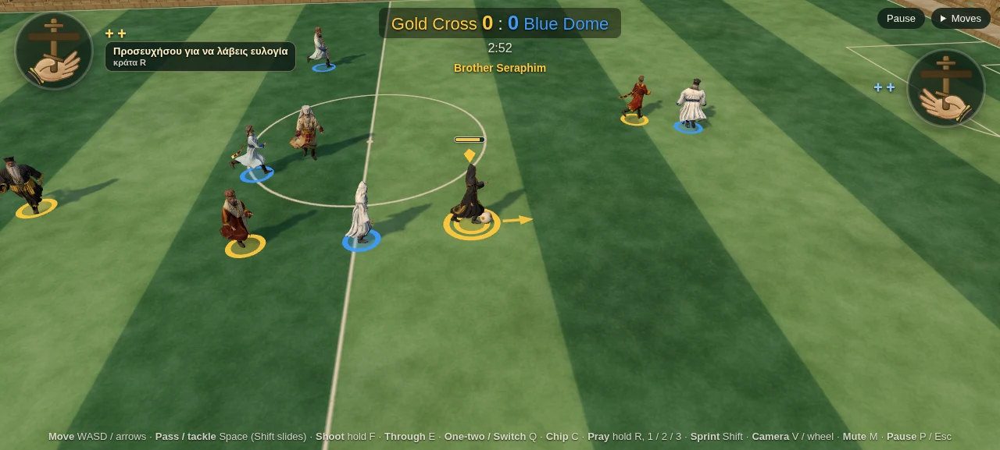 |

---

## Features

### The Priests & Movement Realism
Arcade rules keep every match fast, responsive, and easy to pick up — the effort goes into how the priests move: running, turning, tackling, sliding, kicking, diving saves, celebrations, and flowing cassocks and beards in motion. Two kits face off (**Gold Cross** vs **Blue Dome**) in **3v3** or **5v5** matches officiated by **The Patriarch**:

| Priest | Role | Style |
| :--- | :--- | :--- |
| **Father Luka** | Goalkeeper (`GK`) | Towering purple kamilavka, full-stretch diving parries, strong catches, and aimed punts |
| **Papa Giorgis** | Defender (`DF`) | Broad black kalimavkion, long beard, fearless standing and slide tackles |
| **Brother Seraphim** | Left Midfield (`ML`) | Tall monastic koukoulion, tireless box-to-box running and through balls |
| **Vladyka Ioannis** | Right Midfield (`MR`) | Ornate golden mitre, crisp passing and curling shots from midfield |
| **Diakon Nikolai** | Striker (`FW`) | Fast, nimble forward in a skufia who leads the press and counter-attacks |

### Three Monastery Venues
Play across three distinct 3D stadiums in 3v3 or 5v5 scale:
- **Monastery Courtyard** — sunlit stone cloisters, cypress trees, and red-tiled arches.
- **Meteora Cliff-top** — perched high on sheer rock pillars overlooking the valley.
- **Winter Monastery** — crisp snowfall, frosted pines, and cold-weather floodlights.

| Meteora Cliff-top | Winter Monastery |
| :---: | :---: |
| 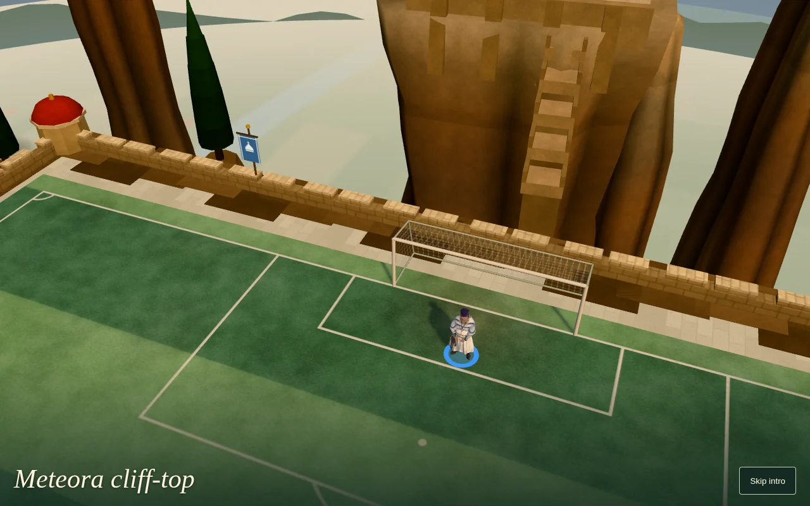 | 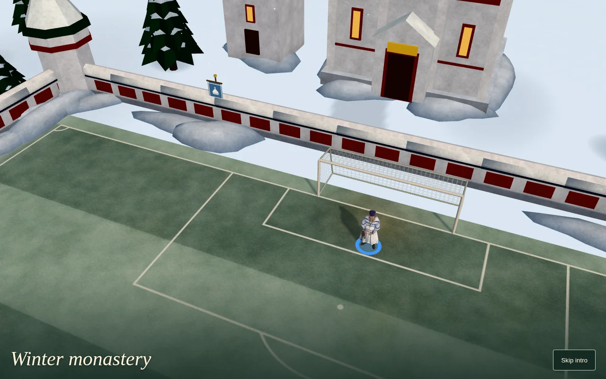 |

### Four Prayers (Divine Blessings)
Each team has **2 prayer slots per match**. Hold the pray control for 2 seconds to fill the cross, then pick a saint:
- **Jesus (uses both slots, 10 s):** descends with a golden aura — your next shot becomes an unstoppable golden beam straight for the net.
- **Mother Mary (1 slot, 12 s):** shields your goal with a luminous celestial-blue barrier that rebounds incoming shots. If a Jesus shot hits Mother Mary's shield, both cancel in a dramatic **Clash** (*"Everyone is God's favorite child"*).
- **St George (1 slot, 15 s):** rides onto the pitch on his white warhorse at **+30% speed**, charging past defenders with robes flying. Tackle the rider and the horse is gone — but he tumbles forward with the ball still at his feet.
- **St Phanourios (1 slot, 15 s):** the finder of lost things. Loose balls curve back to your priests, and your passes find their man from further away.

| Jesus Prayer & Golden Beam | Mother Mary Goal Shield | St George Warhorse (+30% Speed) |
| :---: | :---: | :---: |
| 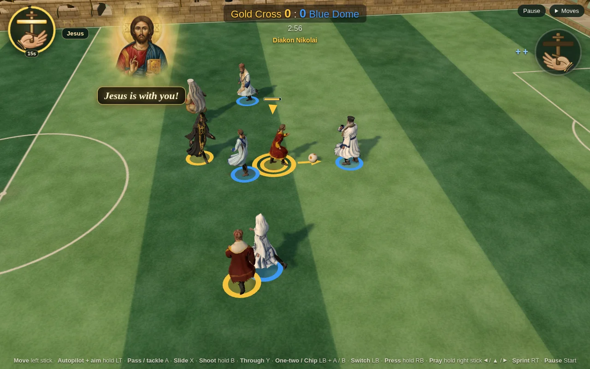 | 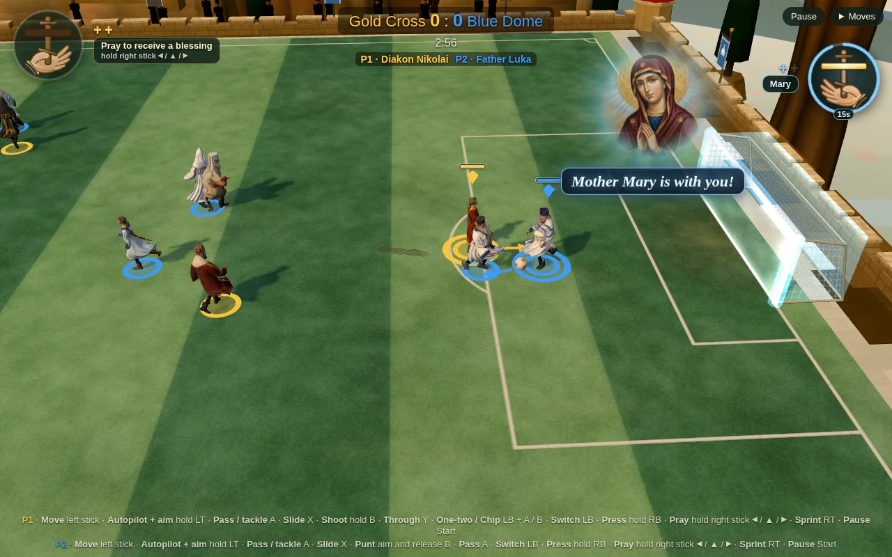 | 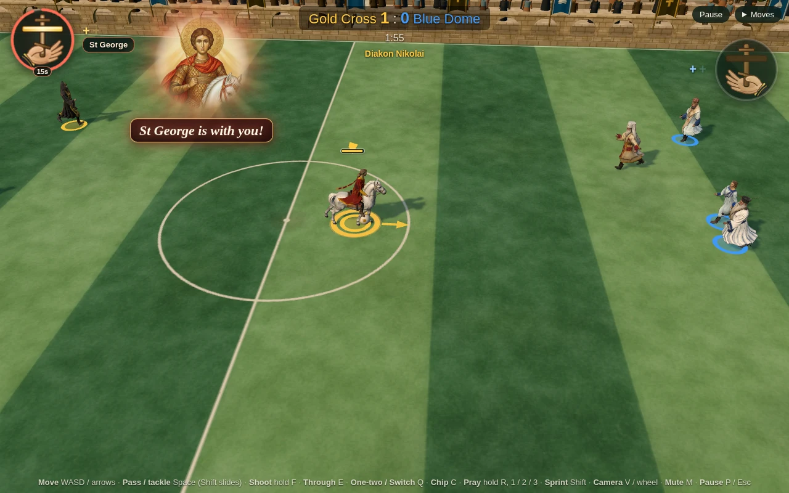 |

### 3D Corner Cameos, Live Commentary & Slow-Motion Replays
- **3D Picture-in-Picture Cameos:** big goals, thunderous goalkeeper catches, and every team's **4th goal** pop animated, lip-synced 3D parody characters into the corner of the screen with synthetic voice lines.
- **Live Narration:** toggleable **English** and **Greek** match commentary (or Off) with automatic sound-effect ducking.
- **Celebrations & Replays:** every goal triggers full-squad celebrations followed by a broadcast-style **`● REPLAY`** slow-motion playback.

| 3D Corner Cameo | Slow-Motion Goal Replay |
| :---: | :---: |
| 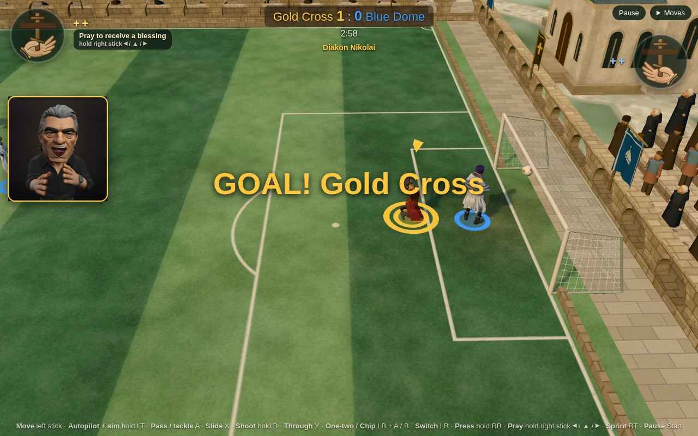 | 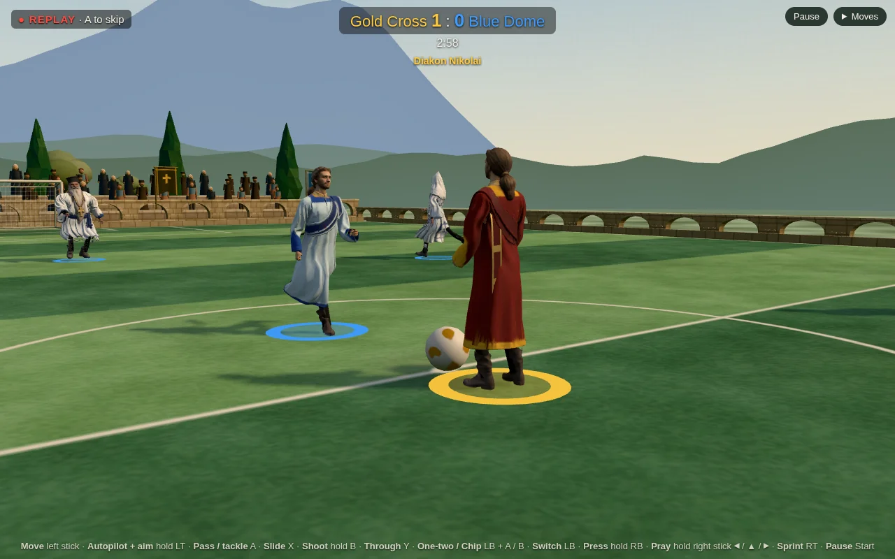 |

### Play Modes & Devices
- **Solo vs AI:** five difficulty levels from *Very easy* to *Very hard*.
- **Interactive Gamepad Tutorial:** a 14-step watch-and-try tutorial with a live on-screen controller diagram teaching every move from dribbling and chips to autopilot aim and prayers.
- **Local 2-Player:** share one screen with two controllers, or one controller + keyboard & mouse.
- **Online 2-Player (Invite Codes, No Server Required):** swap short invite & reply codes (`P1I-…` / `P1R-…`) to connect directly peer-to-peer over WebRTC — no accounts or sign-ups needed.
- **Mobile Touch Controls:** playable on phones and tablets with a virtual movement stick, swipe moves, and touch prayer wheel.

| Interactive Gamepad Tutorial | Local 2-Player on One Screen |
| :---: | :---: |
|  | 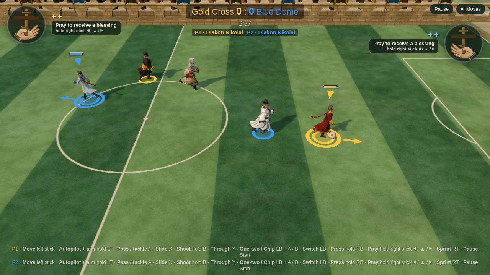 |

| Online 2P Invite Codes | Phone Touch Layout |
| :---: | :---: |
| 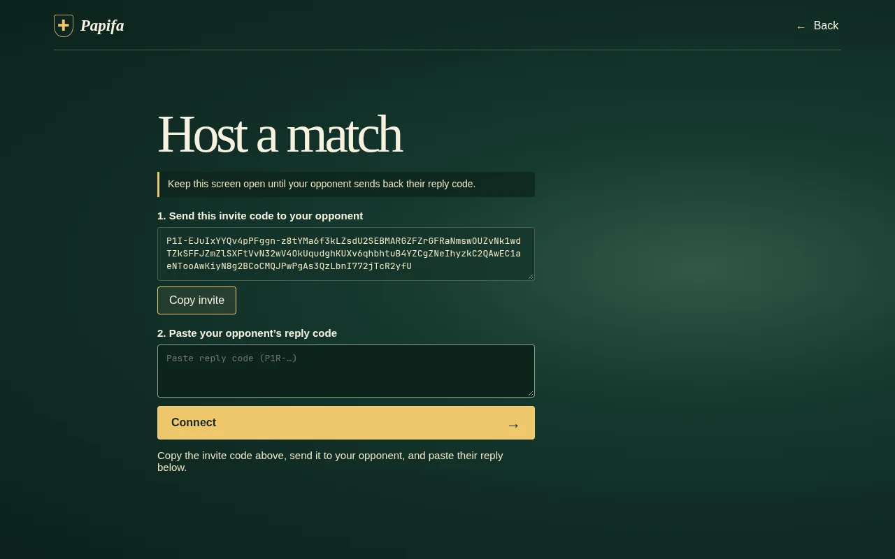 | 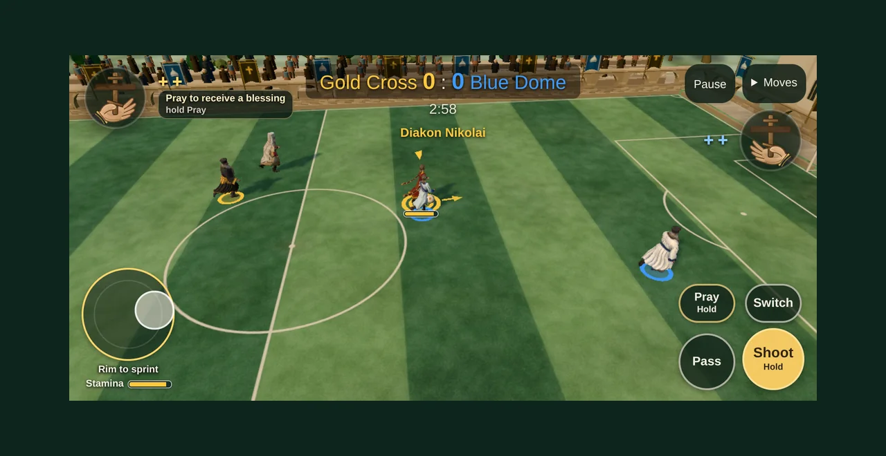 |

---

## Play in the browser

Play immediately online at **<https://metaskepsis.com/papifa/>**, or run your own local copy:

### Option 1: Build a self-contained static web release (recommended)

Requires only **Node.js (LTS)** and **Git**:

```bash
node scripts/build-web.mjs --stage ./staged-web
npx --yes http-server ./staged-web -a 127.0.0.1 -p 8790
```

Then open <http://127.0.0.1:8790/> in a modern browser. The build script downloads and SHA-256 verifies a pinned copy of `three@0.170.0` so the staged release loads nothing from external CDNs and runs under a strict Content-Security-Policy.

### Option 2: Direct local dev server (no build step)

Serve `game/` directly (loads Three.js from jsDelivr):

```bash
python3 -m http.server 8790 --bind 127.0.0.1 --directory game
```

Open <http://127.0.0.1:8790/>.

---

## Build the desktop app (Windows, Linux, macOS)

See **[`BUILDING.md`](BUILDING.md)** for plain, step-by-step instructions to build your own standalone Windows `.exe`, Linux `AppImage` / `.tar.gz`, or macOS `.zip` with only **Node.js (LTS)** and **Git**.

Quick version:

```bash
cd desktop
npm ci
npm run build
```

---

## Controls

**Gamepad recommended** — Xbox, PlayStation, or any standard USB/Bluetooth controller works out of the box, and the title menu includes an interactive **Gamepad tutorial** covering every move. Keyboard + mouse and mobile touch controls are also supported.

| Action | Gamepad (Recommended) | Keyboard + Mouse | Touch |
| :--- | :--- | :--- | :--- |
| **Move** | Left stick | WASD / Arrow keys | Drag movement stick |
| **Aim** | Left stick (hold **LT** for autopilot + aim) | Mouse cursor on pitch | Movement stick |
| **Sprint** | Hold **RT** | Hold **Shift** | Drag stick to rim |
| **Pass / Standing tackle** | **A** | **Space** (or right-click pass / left-click tackle) | Tap **Pass** / **Tackle** |
| **Slide tackle** | **X** (or **RT + A**) | **Shift + Space** | — |
| **Shoot / Knock-on** | Hold **B** to shoot · tap far out (or double-tap **RT**) to knock on | Hold **F** or left-click · tap far out (or double-tap **Shift**) to knock on | Hold **Shoot** · tap far out to knock on |
| **Through ball** | **Y** | **E** (or **Shift + right-click**) | Swipe up on **Pass** |
| **Chip shot** | **LB + B** | **C** | Hold **Shoot**, swipe up & release |
| **One-two** | **LB + A** | **Q** with the ball | Swipe right on **Pass** |
| **Switch / Call press** | Tap **LB** / Hold **RB** | Tap **Q** (or right-click) / Hold **Q** | Tap **Switch** / Hold **Switch** |
| **Pray (2 slots per match)** | Hold right stick 2 s: ◀ Jesus · ▲ St George · ▶ Mother Mary · ▼ St Phanourios | Hold **R** 2 s, then **1** (Jesus) · **2** (Mary) · **3** (St George) · **4** (St Phanourios) | Hold **Pray** 2 s, then tap blessing |
| **Pause / Mute / Fullscreen** | **Start** | **P** or **Esc** · **M** mute · **V** camera · **F11** desktop fullscreen | **Pause** button |

---

## Online & Local 2-Player

- **Local 2P:** play on one computer with two controllers, or one controller + keyboard & mouse.
- **Online 2P (no server required):** click **Host online**, copy the short invite code (`P1I-…`), and send it to your opponent over chat. They paste it in **Join online** and send back their reply code (`P1R-…`). Once the host pastes the reply, the two players connect **directly peer-to-peer over WebRTC** — no account or game server is required.
- **Network & privacy note:** direct WebRTC uses public STUN servers (`stun.l.google.com` and `stun.cloudflare.com`) to discover reachable network addresses. Because the connection is direct, both players and the STUN servers can see each other's IP addresses. Some restrictive mobile data or office/school networks block direct peer-to-peer UDP traffic; if a direct link cannot open, try another network.

---

## Credits & Third-Party Licences

- **[Three.js](https://threejs.org/)** (`0.170.0`) — MIT License (vendored with pinned SHA-256 verification by `scripts/build-web.mjs`).
- **[Electron](https://www.electronjs.org/)** & **Chromium** — MIT License (Electron) and BSD-style / open-source third-party licences (Chromium, bundled inside built desktop packages via `electron-builder`).
- **Fonts:** system UI and serif font stacks only (`system-ui`, `Georgia`, `"Times New Roman"`); no third-party font files are bundled or fetched.

### Parody & Cameo Notice

The short corner-overlay cameo characters are stylized parody caricatures with synthetic AI-generated voices. They are not affiliated with, sponsored by, or endorsed by any person, broadcaster, or organization, and will be removed promptly upon request.

---

## Licences

Papifa is free to play, study, modify and share for **non-commercial** purposes. Selling it, or using it in a paid product or service, is not allowed.

- **Source code** (`game/src/`, `game/tests/`, `desktop/`, `scripts/`, `tools/`): PolyForm Noncommercial License 1.0.0 — see [`LICENSE`](LICENSE).
- **Game assets** (3D models, textures, images, narration, and cameo audio under `game/assets/` and `docs/screenshots/`): Creative Commons Attribution-NonCommercial 4.0 International (CC BY-NC 4.0) — see [`LICENSE-ASSETS`](LICENSE-ASSETS).
